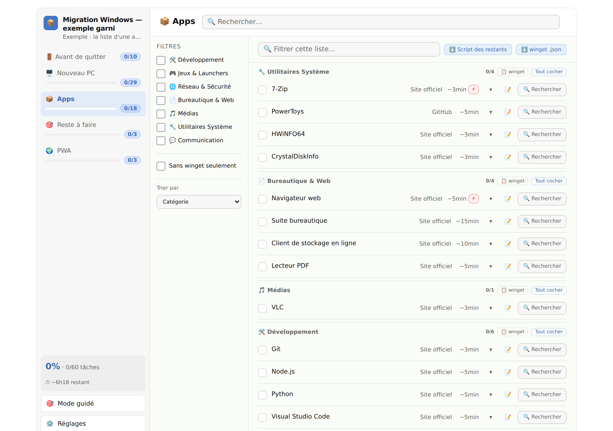
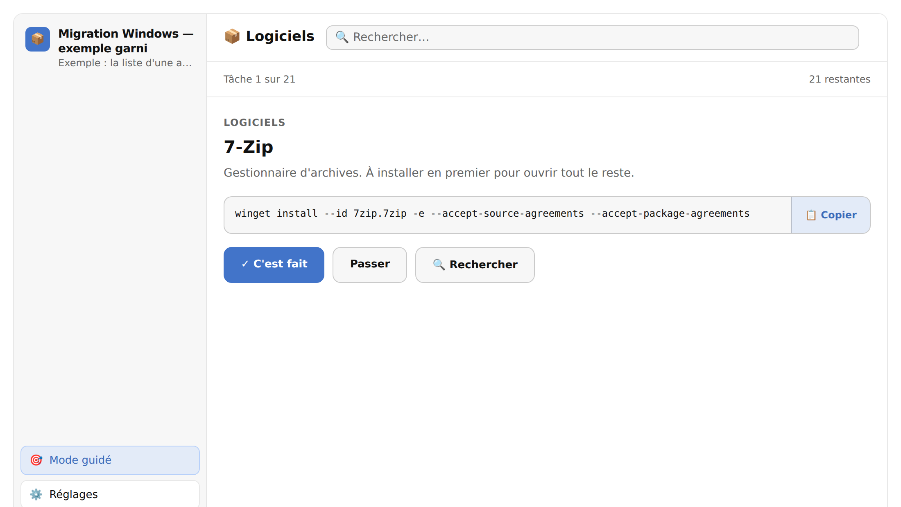

# Migration PC — checklist de réinstallation

Checklist HTML pour réinstaller un PC Windows sans rien oublier. Des scripts PowerShell
relèvent les logiciels installés sur l'ancien PC et les pilotes du nouveau ; la page compare
les deux et dit ce qui manque.

**Ce qu'il fait, et rien d'autre** : lister les logiciels du PC source, ceux du PC cible,
dire la différence — et signaler les périphériques sans pilote sur la cible, avec le lien du
constructeur. Il ne sauvegarde **rien** : vos fichiers personnels restent à votre charge.

**Prérequis** : Windows avec PowerShell 5.1 ou supérieur, déjà présent sur Windows 10 et 11.
`index.html` se suffit à lui-même — aucune dépendance, aucun serveur, aucune étape de
construction — et s'ouvre depuis une clé USB sur un PC fraîchement installé, sans réseau.
Les scripts sont facultatifs.

*English: [README.en.md](README.en.md).*

## Démarrage

Posez le dossier entier sur une clé USB. Un seul fichier se lance, **`Migration PC.bat`** ;
tout le reste est dans `scripts/`, là pour être lu.

1. Clé branchée sur le **PC que vous quittez** : double-cliquez `Migration PC.bat`,
   choisissez **SOURCE**. La page s'ouvre déjà remplie de vos logiciels.
2. Branchez la clé sur le **PC cible** — le neuf, ou le même une fois réinstallé.
3. Double-cliquez `Migration PC.bat`, choisissez **CIBLE**. La page s'ouvre sur ce qu'il reste
   à installer : **📦 Logiciels** dit ce qui manque, **🎛️ Pilotes** montre les périphériques
   sans pilote et le lien du constructeur.
4. Relancez `Migration PC.bat` : il propose **Installer ce qui manque**. Il montre la liste,
   attend que vous tapiez `INSTALLER` (ou `INSTALL`), puis joue `winget import`. C'est la
   seule action du programme qui change la machine ; rien ne s'enchaîne tout seul.

**Entre les deux, sauvegardez vos fichiers personnels** : le scan liste, il ne copie rien, et
ce projet n'outille pas cette étape.

```
PC SOURCE                                        PC CIBLE
(celui qu'on quitte)                (le neuf, ou le même réinstallé)
────────────────────                ───────────────────────────────
scan-pc.ps1 -Role source                  scan-pc.ps1 -Role cible
        │                                           │
        └──► instantane-source-AAAA-MM-JJ.json ──┐  └──► instantane-cible-….json
                                                 │              │
                                                 └──► index.html ◄┘
                                                    compare les deux
```

Le même script tourne des deux côtés : il fige l'état de la machine, et c'est la page qui
compare. « PC neuf » et « même PC réinstallé » sont donc le même cas. Chaque instantané porte
sa date et n'écrase jamais le précédent ; `inventaire-pc.json` pointe vers le dernier. Le menu
devine de quel côté vous êtes quand la clé porte l'instantané d'une autre machine (numéro de
série SMBIOS différent) ; sinon il pose la question, et **Par où commencer ?** décrit les
trois situations : changer de PC, réinstaller sur place, garder les deux machines. Le scan
n'est pas obligatoire : `index.html` s'ouvre seul sur un profil d'exemple.

> Windows affiche un avertissement SmartScreen sur un `.bat` téléchargé : « Informations
> complémentaires », puis « Exécuter quand même ». Aucune astuce ne l'évite sans certificat de
> signature payant. Le `.bat` n'existe que parce que Windows refuse d'exécuter un `.ps1` par
> double-clic, et il reste lisible dans le Bloc-notes, contrairement à un `.exe`.

### Langue

Page et scripts parlent français et anglais. La page suit la langue du navigateur, et les
boutons **FR** / **EN** la changent. Les scripts suivent celle de Windows ; `-Langue fr` ou
`-Langue en` tranche, y compris sur le lanceur : `Migration PC.bat -Langue en`. Un profil que
vous chargez n'est pas traduit, et un profil exporté repart avec son texte d'origine.

### Comment les deux machines se parlent

La mémoire locale de la page ne traverse pas d'un navigateur à l'autre. La clé sert donc de
relais : le scan de la source dépose son instantané à côté de `index.html`, sous le nom
`instantane-source.json`, et celui de la cible le relit. Un navigateur interdit à une page
ouverte en `file://` de lire un fichier mais l'autorise à charger un script voisin : les
scripts écrivent donc aussi `resultat-scan.js`, et ouvrir `index.html` suffit. Ce fichier est
**exécuté** : sans objet sur votre clé, c'est du code qui tourne sur une clé prêtée. La page
traite ce qu'il dépose comme n'importe quel import, des données jamais des instructions, et
annonce d'où ça vient. `-PasDOuverture` empêche d'ouvrir le navigateur.

## Aperçu

L'onglet **Logiciels** : la liste relevée sur l'ancien PC, par catégorie, avec version, poids
et commande de réinstallation.

<picture>
  <source media="(prefers-color-scheme: dark)" srcset="captures/checklist-sombre.png">
  
</picture>

Le **mode guidé**, pour le jour de l'installation : une tâche à l'écran, « c'est fait » ou
« passer », et rien d'autre.

<picture>
  <source media="(prefers-color-scheme: dark)" srcset="captures/mode-guide-sombre.png">
  
</picture>

## Ce que le scan relève

| Source | Ce qu'elle apporte |
|---|---|
| `winget list` | Les identifiants d'installation officiels |
| Registre `Uninstall` | Les logiciels installés classiquement (32 et 64 bits, machine et utilisateur) |
| Paquets APPX | Les applications du Microsoft Store |
| Steam, Epic, GOG, Xbox, Ubisoft, EA | Les jeux installés, sur tous les disques |
| WMI et registre | La machine : fabricant, modèle, n° de série, portable ou fixe, écrans branchés |
| `Win32_PnPSignedDriver` | Les pilotes qui ne viennent pas de Microsoft, groupés par classe |

Une entrée vue par plusieurs sources est fusionnée : le nom vient du registre, l'identifiant
de winget, la taille de la source qui la connaît. Le rapprochement source/cible se fait sur le
nom normalisé avec les mêmes règles des deux côtés, sinon « Mozilla Firefox (x64 fr) » et
« Mozilla Firefox » compteraient pour deux. Rien n'est coché sans votre validation : un
rapprochement par nom peut confondre deux logiciels voisins. Sur la cible, le script relève
aussi les périphériques que Windows signale sans pilote ou en erreur.

Il a relevé autrefois bien d'autres choses — réglages, favoris, Wi-Fi, polices, VPN, machines
virtuelles. Ces relevés fonctionnaient et ont été retirés : le programme listait sans jamais
copier, et une liste de ce qu'on va perdre laissait croire à une sauvegarde juste avant un
formatage. [COUVERTURE.md](COUVERTURE.md) dit lesquels et pourquoi.

### En ligne de commande

```powershell
powershell -ExecutionPolicy Bypass -File .\scripts\scan-pc.ps1 -Role source
powershell -ExecutionPolicy Bypass -File .\scripts\scan-pc.ps1 -Role cible
```

| Option | Effet |
|---|---|
| `-Role source\|cible` | De quel côté on est. `source` par défaut |
| `-Sortie <chemin>` | Change le fichier produit (défaut : `instantane-<role>-<date>.json`) |
| `-SansStore` | Ignore les applications du Microsoft Store |
| `-SansJeux` | Ignore les bibliothèques de jeux |
| `-ToutInclure` | Garde aussi les redistribuables et les composants système |
| `-PasDOuverture` | N'ouvre pas le navigateur à la fin |
| `-Langue fr\|en` | Langue des messages. Celle de Windows par défaut |

Le scan de la cible écrit aussi `winget-restant.json` : la liste de ce qui manque, au format
`winget import`, que le menu joue. PowerShell la calcule, et non la page, parce que le fichier
de la page part dans le dossier des téléchargements, que le menu ne retrouve pas de façon
fiable.

## La page

**Logiciels** est la liste du PC source, par catégorie. Dès que le scan de la cible arrive,
chaque ligne porte son verdict — *là*, *manque*, ou *plus ancien* avec les deux versions — et
la page ouvre sur la réponse : « N à installer », les lignes concernées et le bouton qui
produit le fichier `winget import`. La liste complète se replie derrière « Voir les X
logiciels relevés ». Une ligne que le scan a trouvée est **réglée d'office** : cochée, non
décochable, parce qu'un constat n'est pas une décision. Une version plus ancienne fait
exception : la ligne reste à décider, on veut peut-être remettre à niveau. Le scan n'écrit
jamais dans vos cases. Si un verdict « là » est faux, le rapprochement par nom s'est trompé :
corrigez le nom dans le JSON et relancez.

**Écarter.** Le bouton ⊘ d'une ligne l'écarte : elle reste affichée, grisée et barrée, mais
sort du « N à installer », des barres de progression, du mode guidé et du script winget. Le ↩
la remet. Ça vaut aussi pour Pilotes. Les lignes écartées vivent dans ce navigateur seulement :
elles ne voyagent pas avec le profil exporté, survivent à « Tout décocher » et partent avec
« Tout effacer ». **Limite** : le `winget-restant.json` du scan est
calculé par PowerShell, qui ne lit pas votre navigateur, donc il **ignore vos lignes
écartées** — relisez la liste avant de taper `INSTALLER`. L'export **⬇️ winget .json** de la
page, lui, les respecte.

**Pilotes** montre, après le scan du PC receveur, les périphériques en défaut, ceux déjà en
place par fournisseur, et le lien de support du constructeur construit depuis le modèle et le
numéro de série du SMBIOS. Il ne dit **jamais** qu'une version plus récente existe : le
programme ne fait aucun appel réseau, il ne peut pas le savoir. **PWA** liste les
applications web installées depuis le navigateur.

**Réinstaller.** Le badge winget copie la commande en un clic, un bouton par catégorie copie
le script de la section. Deux exports : **⬇️ winget .json**, le format officiel, à préférer
— il saute ce qui est déjà installé et reprend après une interruption — et **⬇️ Script des
restants**, un `.ps1`. Sans scan de la cible, ce script part des cases non cochées ; avec la
comparaison, c'est elle qui décide, et une ligne cochée à la main reste exclue.

```powershell
winget import -i winget-restant.json --accept-package-agreements --accept-source-agreements
```

**🎯 Mode guidé**, devant la machine : une tâche à la fois, dans l'ordre des dépendances, avec
la commande winget prête à copier. « C'est fait » coche et avance, « Passer » remet la tâche
en fin de file.

**Menu et annulation.** Importer, exporter le profil (un seul fichier : listes **et** cases
cochées), affichage compact, thème, ma configuration, imprimer, réinitialiser. *Tout
décocher* remet la progression à zéro et garde le profil ; *Tout effacer* revient au profil
d'exemple. Réinitialiser et importer passent par un bandeau d'annulation plutôt que par une
confirmation : une seconde chance après coup vaut mieux qu'un « oui » réflexe avant. Elle rend
les cases, le profil remplacé **et** la configuration matérielle.

**Le reste.** Recherche sur les trois onglets, filtres, vue compacte, thème suivant le
système, barres de progression ; l'enregistrement est continu et la barre « Récent » avertit
quand le navigateur refuse d'écrire. Tout se fait au clavier, les contrastes respectent le
seuil WCAG 4,5:1 dans les deux thèmes, et « réduire les animations » est respecté. Depuis la
version en ligne (HTTPS) la page s'installe comme une application ; ouverte depuis une clé,
elle est déjà autonome.

**Il n'y a ni durée ni priorité par logiciel, et c'est voulu** : le scan les fabriquait
d'après le nom ou la catégorie, et la page en tirait un total présenté comme une mesure, le
seul chiffre qu'on ne pouvait pas vérifier. Une catégorie approximative reste : son erreur se
voit d'un coup d'œil.

### Ma configuration

Des champs saisissables à la main, que les scripts remplissent : carte mère, processeur, carte
graphique, mémoire, SSD, puis ce qui sert à retrouver un pilote — réseau filaire, Wi-Fi, puce
audio, BIOS avec sa date. Ils précisent les intitulés et ciblent la recherche du bon pilote.
Une valeur saisie n'est jamais écrasée, sauf par le scan `-Role cible`, qui tourne sur le PC
qu'on équipe et seul sait de quelle machine il parle. Ce bloc ne devine **pas** quel pilote va
avec quel modèle : il faudrait une table que personne ne tient à jour. La configuration
voyage avec le profil exporté, dans un champ `materiel`.

## Vie privée et sécurité

Tout reste sur votre machine : la page est un fichier statique sans appel réseau, la
progression et le profil vivent dans le stockage local du navigateur, les exports sont des
téléchargements ordinaires. Ce stockage est lié au navigateur **et** au chemin du fichier : si
la lettre de lecteur de la clé change d'un PC à l'autre, la progression ne suit pas, et
l'export JSON est le seul transfert fiable.

**L'inventaire décrit précisément votre machine** — modèle, numéro de série, tout ce qui est
installé. Ne le publiez pas. Le scan suit une règle : **le nom dans l'inventaire, le secret
ailleurs.** Il relève le chemin d'un fichier de licence mais pas son contenu, les cinq
derniers caractères d'une clé de produit mais jamais la clé complète, et ne collecte ni clés
Wi-Fi, ni clé de récupération BitLocker, ni mots de passe Windows : la commande qui les donnerait
existe, et ce fichier voyage sur une clé USB qui se perd.

**Un profil reçu est une entrée non fiable.** Tout ce qu'il contient est échappé avant
d'atteindre la page, et l'adresse d'un raccourci n'est ouverte que si c'est du `http`, `https`
ou `mailto` : un `javascript:` devient un bouton inerte. `tests/test-profil-hostile.js` rejoue
un profil piégé à chaque publication.

## Limites connues

**La détection n'a jamais été exécutée sur une machine Windows réelle.** La logique est
couverte par des tests sur données écrites à la main ; la lecture du registre, des paquets du
Store et des bibliothèques de jeux demande Windows, et ce code est relu, pas éprouvé. Si un
résultat vous paraît faux, c'est probablement là. [VERIFIER-SUR-WINDOWS.md](VERIFIER-SUR-WINDOWS.md)
dit comment le vérifier.

**Le projet ne sauvegarde rien**, et ne déménage pas vos applications : les applications du
Store ne se copient pas, les licences liées au matériel se désactivent, et on déménagerait
cinq ans de restes. Une réinstallation propre par winget couvre l'essentiel. Il n'y a pas non
plus de checklist d'installation (BIOS, TPM, XMP) : le programme ne savait pas la vérifier.

**Tous les logiciels n'ont pas d'identifiant winget.** Ceux que seul le registre détecte
sortent avec un lien de recherche, et sont absents de l'export `winget .json`. Un export winget
importé perd les noms d'origine (`7zip.7zip` donne « 7zip »), alors que `scan-pc.ps1` lit le
registre et les donne corrects.

**Quelques approximations.** La déduplication ignore la version : Python 3.12 et 3.13 donnent
une seule ligne. Le classement par catégorie repose sur des mots-clés et se corrige dans le
JSON. Les tailles sont exactes pour Steam et Epic, estimées par le registre, absentes pour le
Store, GOG et Xbox : le total est un minimum.

**Windows uniquement.** Copiez le dossier entier : `lib-detection.ps1` doit rester à côté des
scripts. S'ils refusent de démarrer, lancez-les avec `-ExecutionPolicy Bypass`.

## Licence

**GNU AGPL v3 ou ultérieure.** Le code est ouvert : vous pouvez le lire, l'utiliser, le
modifier et le redistribuer. La contrainte est une réciprocité : si vous distribuez une version
modifiée, **ou la faites tourner comme service en ligne**, vous publiez votre code sous la même
licence. Quelqu'un peut reprendre ce travail, personne ne peut le refermer. Le projet a
d'abord été publié sous licence MIT, du 24 au 26 septembre 2026 ; les versions distribuées
pendant cette période restent sous MIT.

## Pour aller plus loin

- [COUVERTURE.md](COUVERTURE.md) — ce que le scan détecte, refuse de détecter, et l'historique
  de ce qui a été retiré.
- [FORMATS.md](FORMATS.md) — les formats que la page importe, et comment écrire son profil.
- [VERIFIER-SUR-WINDOWS.md](VERIFIER-SUR-WINDOWS.md) — le premier essai sur une vraie machine,
  et ce qui **n'est pas** un défaut.
- [RESTE-A-FAIRE.md](RESTE-A-FAIRE.md) — ce qui est en attente.
- [CONTRIBUER.md](CONTRIBUER.md) — les tests, la CI, la publication.
